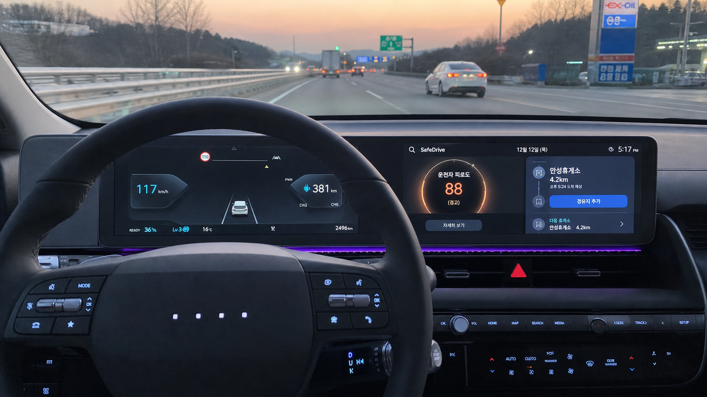

# SafeDrive (세이프 드라이브)

현대자동차그룹 차량용 앱 개발 공모전(Pleos App Market) 출품작
차량 센서 기반 피로도 분석과 휴식 안내


더 뉴 아이오닉 5 파노라믹 커브드 디스플레이(ccNC / Pleos OS) 환경을 가정해 만든 화면 목업입니다.

## 1. 프로젝트 개요

- 앱명: SafeDrive (세이프 드라이브)
- 참가자: 개인 참가 (대학생 부문)
- 한 줄 소개: 차량에서 읽은 주행 데이터로 운전자의 피로를 판단하고, 피로가 쌓이는 시점에 경로상 휴게소를 먼저 제안해 쉬어가도록 돕는 앱입니다.
- 목표
  - 조향각, 차선 유지 보조 개입, 속도와 페달 조작 변화를 함께 보고 피로 지수(0~100)를 계산합니다.
  - "2시간 주행" 같은 시간 기준 알림 대신, 실제 운전 패턴이 흔들리는 시점에 알립니다.
  - 경고에서 끝내지 않고 지금 들를 수 있는 휴게소를 음성으로 제안하고, 운전자가 승인하면 경유지로 등록합니다.

## 2. 테스트 환경과 화면 규격

공모전 공지(비공개 GitHub 저장소 제출 방법 및 접수 관련 추가 안내)에 따라 개발·테스트 환경을 적어 둡니다.

- 실행 환경: Pleos Connect 에뮬레이터 (Pleos Playground), Android API 28+
- 플랫폼: Android API 28 이상(minSdk 28), Kotlin 1.9, Gradle 8.0 이상(Kotlin DSL)
- 화면 규격: 1920 x 720 px, 12.3인치 와이드 디스플레이 기준(가로 고정)
- 테마: 주행 중 눈부심을 줄이는 다크 테마
- 실행 방법: Android Studio에서 프로젝트를 열고 `app` 모듈을 에뮬레이터에 설치해 실행합니다. 차량 센서가 없는 환경에서는 앱 아래쪽 시연 버튼으로 세 가지 주행 시나리오를 재생할 수 있습니다.
- 에뮬레이터 없이 화면과 흐름만 보려면 웹 시뮬레이터를 쓰세요: https://jongwon0922.github.io/SafeDrive/

## 3. 시스템 구성

```
com.hyundai.pleos.safedrive/
├── data/
│   ├── model/           차량 센서 값, 피로 분석 결과, 휴게소 데이터 모델
│   └── sensor/          센서 스트림 소스 (시연용 모의 데이터 포함)
├── domain/
│   ├── analyzer/        피로 지수 계산 엔진 (10분 슬라이딩 윈도우, EMA)
│   └── concierge/       경로상 휴게소 선택과 음성 안내 문구 생성
└── presentation/
    ├── MainActivity          1920x720 다크 테마 대시보드
    └── SafeDriveViewModel    센서 스트림 수집과 상태 관리
```

MVVM과 Clean Architecture를 기준으로 나눴습니다. 화면은 상태만 그리고 판단은 domain에 모아 두어, 센서 데이터 소스를 바꿔도 화면 코드를 건드리지 않게 했습니다.

## 4. 사용하는 Pleos Connect SDK와 향후 확장

공모전 개발 범위 안내(개발 범위 및 기술 문의 안내)에 맞춰, 공개된 SDK 다섯 가지 범위 안에서 동작하도록 설계했습니다.

사용하는 SDK
- Vehicle SDK: 조향각, 차속, 액셀·브레이크 입력, 차선 유지 보조 상태를 구독해 피로 지수의 입력으로 씁니다.
- NaviHelper SDK: 현재 경로와 경유지를 읽고, 경로 주변 휴게소를 찾아 경유지로 추가합니다.
- FusedLocation SDK: 현재 위치와 진행 방향을 확인합니다.
- TextToSpeech SDK / SpeechToText SDK: 안내 음성을 내보내고 "응", "취소", "경유지 추가" 같은 짧은 답을 받습니다.
- Android MediaSession / AudioManager: 안내 음성이 나올 때 재생 중인 음악 볼륨을 줄였다가 되돌리고, 음악 앱에 재생을 요청합니다.

향후 확장 (이번 공모전 공개 SDK 범위 밖)
- 공조 전환(내기·외기), 앰비언트 무드램프 색상, 운전석 시트 햅틱 같은 차량 바디 제어는 공개된 SDK에 포함되지 않아 구현하지 않았습니다. 지금은 안내 문구로 대신하고, 차량 제어 API가 열리면 연동할 계획입니다.

## 5. 차량 순정 시스템 연동 방식

내비게이션 (NaviHelper)
- 운전자가 잡아 둔 목적지는 그대로 두고 휴게소만 경유지로 끼워 넣습니다.
- 순정 지도 화면을 가리지 않도록 앱 화면은 우측 슬림 카드로만 띄웁니다. 멀티 윈도우에서 지도와 함께 볼 수 있습니다.

오디오 (MediaSession)
- 안내 음성과 음악이 겹치지 않게 볼륨을 잠깐 낮췄다가 원래대로 돌립니다.
- 2단계(피로 주의)에서는 음악 앱에 리프레시 플레이리스트 재생을 요청합니다.

화면
- 다크 테마, 큰 글자, 터치 타깃 76dp 이상.
- 주행 중에는 터치 없이 음성으로 끝나도록 했습니다.

## 6. 실행과 시연

1. 정상 주행: 속도 98km/h, 조향이 안정적. 피로 지수 15점(정상).
2. 피로 주의: 조향 미세 흔들림과 차선 이탈 보조 개입이 늘어남. 피로 지수 65점. 환기와 음악을 제안합니다.
3. 위험: 보조 개입이 급증. 피로 지수 85점. 전방 휴게소 카드와 음성 안내가 나오고, "경유지로 등록"을 누르면 경로에 추가됩니다.

시연 버튼은 앱 아래쪽에 있습니다. 각 단계는 20~30초면 확인할 수 있습니다.

## 7. 개발 현황과 남은 일

완료
- 안드로이드 프로젝트 구성(minSdk 28, Kotlin, MVVM + Clean Architecture)
- 피로 지수 계산 엔진(10분 슬라이딩 윈도우, 3단계 판정)
- 경로상 휴게소 선택과 음성 안내 문구 생성
- 1920x720 다크 테마 대시보드
- 웹 시뮬레이터(브라우저에서 바로 확인)

진행 예정
- Pleos Connect 에뮬레이터에서 모의 센서 대신 Vehicle·NaviHelper SDK 실데이터로 바꿔 구동 확인
- release APK 빌드 후 저장소에 업로드
- 2차 PT(12월 3~4일) 시연 리허설

## 8. 공모전 제출 서류

- 기획서(접수양식): `SafeDrive_현대차공모전_기획서_임종원.docx` — 이메일 제출
- 소스 코드: 이 저장소 — 선택 제출(가산점)
- 웹 시뮬레이터: https://jongwon0922.github.io/SafeDrive/
