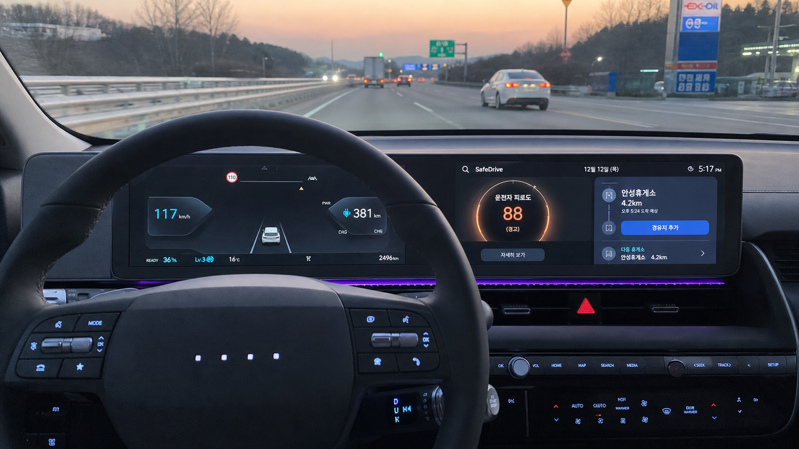

# SafeDrive (세이프 드라이브) 🛡️
> 현대자동차그룹 차량용 앱 개발 공모전 (Pleos App Market) 출품작
> **차량 센서 기반 스마트 피로도 분석 및 휴식 컨시어지**



---

## 📌 1. 프로젝트 개요 (Overview)
- **앱명**: SafeDrive (세이프 드라이브)
- **참가자**: 임종원 (대학생 부문 · 개인)
- **개발 환경**: Android API Level 28+ (Pie / Automotive OS 호환), Kotlin 1.9+, Gradle 8.0+
- **핵심 목표**: 
  1. 기존 내비게이션의 획일적인 '단순 시간 경고'를 탈피하여, 차량 CAN 센서 데이터(Vehicle SDK) 기반의 **실시간 운전자 피로도 정밀 감지**
  2. 단순 잔소리성 경고가 아닌 **가고 싶은 휴게소(맛집·주차 여유)를 능동적으로 제안(Nudge)**하여 운전자의 자발적 휴식 유도
  3. 100% 음성(TTS/STT) 인터페이스와 직관적인 Automotive Dark Mode 대화면 UI로 **운전자 시선 분산 방지(Driver Distraction Guidelines) 완벽 준수**

---

## 🏗️ 2. 시스템 아키텍처 및 핵심 모듈
SafeDrive는 **Clean Architecture**와 **MVVM 패턴**을 기반으로 설계되었습니다.

```
com.hyundai.pleos.safedrive/
├── data/
│   ├── model/           # 차량 텔레메트리, 피로도 분석 결과, 휴게소 데이터 모델
│   └── sensor/          # Pleos Vehicle SDK 연동 및 실시간 시뮬레이션 데이터 소스
├── domain/
│   ├── analyzer/        # 4대 센서 융합 피로도 판별 알고리즘 엔진 (Sliding Window & EMA)
│   └── concierge/       # Pleos NaviHelper 연동 경로상 휴게소 추천 및 TTS 브리핑 생성
└── presentation/
    ├── MainActivity     # Automotive 대화면 규격 고대비 Dark Mode 대시보드
    └── SafeDriveViewModel # 센서 스트림 수집 및 실시간 상태 관리
```

---

## 💡 3. Pleos Connect SDK 활용 상세

### 1) Vehicle SDK (주행 동역학 센서)
- **Steering Wheel Angle**: 조향 고착 및 미세 급보정(Jitter) 표준편차 실시간 추적
- **Speed & Pedals**: 액셀/브레이크 급조작 및 속도 불규칙 변동률 산출
- **Lane Keep Assist (LKA)**: 차선 이탈 방지 보조 개입 빈도 누적 집계

### 2) NaviHelper SDK (경로 및 경유지)
- 현재 고속도로 주행 경로 상의 전방 3~10km 내 최적 휴게소 POI 자동 탐색
- 운전자 원클릭/음성 승인 시 `addWaypoint()`로 경유지 즉시 자동 등록

### 3) TTS / SpeechToText SDK
- 화면 주시를 배제한 Eyes-Free 음성 브리핑:
  - *"종원님, 전방 4km 앞 안성휴게소에 들러보세요. 주차가 여유로우며 스타벅스와 원조 소떡소떡이 준비되어 있습니다. 경유지로 등록할까요?"*

---

## 🎮 4. 시연 및 에뮬레이터 테스트 가이드
앱 화면 하단의 **시연 시뮬레이터 버튼**을 통해 심사위원이 즉시 3가지 주행 시나리오를 검증할 수 있습니다:
1. **[1. 정상 주행]**: 속도 98km/h, 부드러운 조향 → 피로 지수 15점 (초록색 정상 상태)
2. **[2. 피로 주의]**: 장거리 주행 + 미세 조향 떨림 발생 → 피로 지수 65점 돌파 → 실내 공조 환기 가동 및 경쾌한 음악 재생 안내
3. **[3. 위험 졸음]**: 차선 이탈 보조 개입 급증 → 피로 지수 85점 (빨간색 위험 상태) → 우측에 **안성휴게소 추천 카드** 즉시 표출 및 TTS 음성 안내 → `[경유지로 등록]` 터치 시 내비게이션 경유지 자동 설정 완료

---

## 📄 5. 공모전 제출 서류
- **기획서(접수양식 DOCX)**: `SafeDrive_현대차공모전_기획서_임종원.docx`
- **소스 코드 저장소**: 본 GitHub 저장소 (가산점 제출용)
